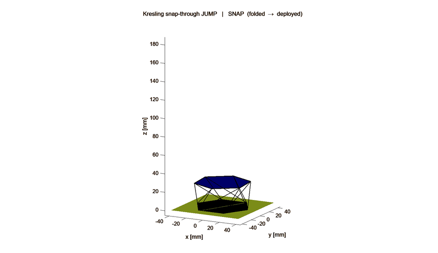
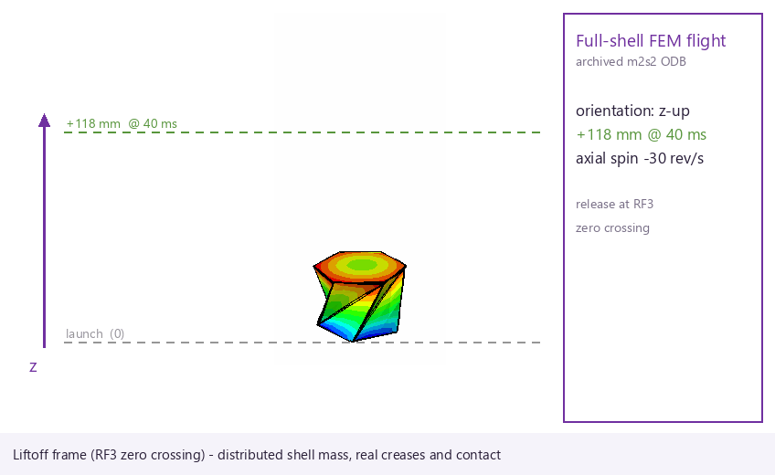

# Kresling origami design platform

Explore how crease stiffness, mass and rotational inertia affect the predicted jump and spin of a Kresling origami cell. Use the inverse search to find candidate designs for a target jump height and spin.

**[Launch the interactive design platform](https://vegeta777-creator.github.io/kresling-design-platform/)**

Compare the predicted jump and twist in the two simulations.

| Reduced-order model | Abaqus finite element model |
| --- | --- |
|  |  |

## Run locally

Download or clone this repository and open `index.html` in a browser. The interface loads the trained DeepONet weights and design data locally. It includes reduced-model and Abaqus simulation animations.

## Model and validation

The surrogate was trained on 192 reduced-model samples and tested on 48 held-out samples. Selected forward simulations were compared with finite element results. Inverse candidates require independent simulation and physical testing. See [the training report](DEEPONET_TRAINING_REPORT.md). Rebuild the browser data from the included CSVs with `python build_platform_data.py`.

Mechanics reference: Zang et al., [Kresling origami mechanics explained: Experiments and theory](https://doi.org/10.1016/j.jmps.2024.105630), JMPS (2024).
